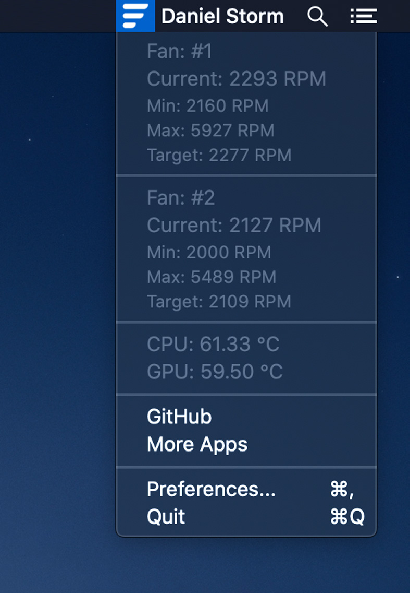
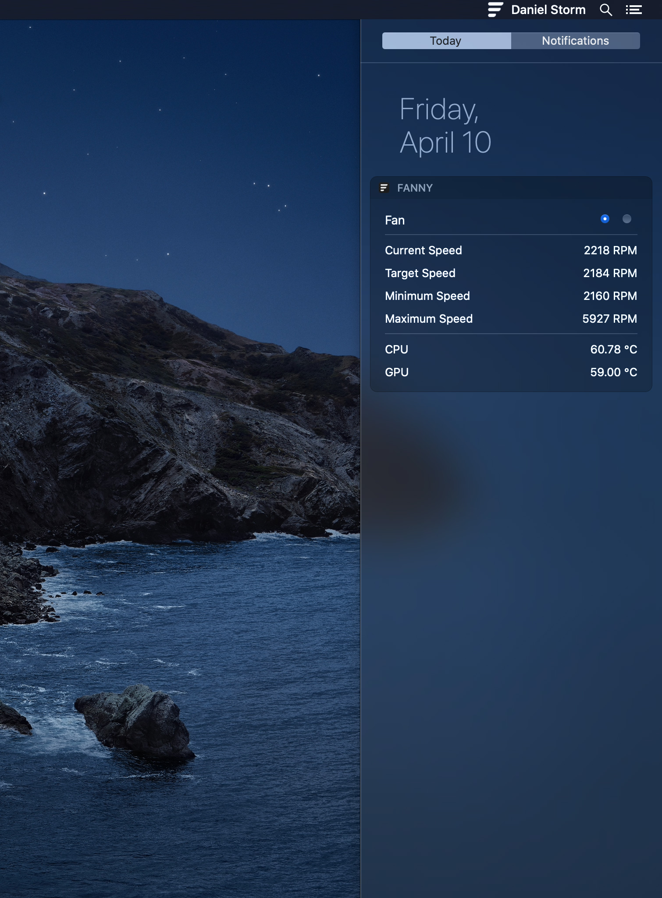

---

Fanny is a free, open source menu bar app to monitor your Mac's fan speeds and CPU and GPU temperatures. It requires macOS 27 or later on Apple silicon.

- Compact design allowing you to keep an eye on your systems fans and CPU/GPU temperature while not cluttering up your work space.
- Get information on; current speed, target speed, minimum speed, maximum speed, number of fans, and CPU/GPU temperature.
- Glance at your Mac's fan stats from the menu bar menu, a floating window, or WidgetKit widgets (small to extra large). Siri and Shortcuts are supported.

## Installation

Download newest release from [Github.com](https://github.com/DanielStormApps/Fanny/releases/latest)

Or install via HomeBrew.

```plain
brew install --cask fanny
```

## Examples




## URL List

- [Fannywidget.com](https://www.fannywidget.com)
- [Github.com - Fanny](https://github.com/DanielStormApps/Fanny)
